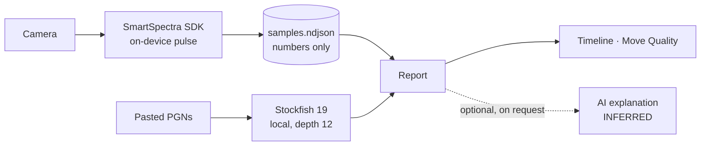

# ChessPulse

ChessPulse is a local desktop app for reviewing a chess.com session after you play. While you play,
it measures your pulse from the camera. Afterwards you paste the session's PGNs. ChessPulse scores
your moves with a local Stockfish and lines up pulse, clock, think time, and mistakes on one
timeline, so you can see whether a bad stretch came with a raised pulse or not.

It is not a chess trainer, not an engine overlay, and not a medical device. It makes no diagnosis
and no claim about health, stress, or mental state.

**Fair play.** ChessPulse never runs an engine, shows an evaluation, or gives advice while a game is
live. You play on chess.com with nothing on screen but the pulse strip. Stockfish runs only after
you stop sensing and paste games that are already finished.

## How it works



1. **Setup** checks the camera, the key, and the light, then asks for camera consent.
2. **Sensing**: you play on chess.com. Press **Game ended** after each game and **Next game started**
   before the next one. If your pulse in the last minute is well above your baseline, one line
   suggests a break and shows the measured figures.
3. **Paste PGNs** after you stop. On chess.com, choose Share, then PGN, and tick the timestamps box
   (the clock icon) so each move carries its clock time. If the games show more than one shared
   username, ChessPulse asks which player you are and scores only your moves.
4. **Report**:
   - a summary header with baseline, elevated threshold, coverage, and blunders, each defined;
   - the **Pulse & Play Timeline**, with pulse, games, move loss, and think time on one clock;
   - **Move Quality**, overall and per game, with links from the largest mistakes to the timeline;
   - an optional **AI Session Explainer**, which sends nothing until you ask.

If too little of the session has a usable pulse signal, ChessPulse refuses to compare and says why.
It does not produce a weak report.

### Example sessions

Home lists two real sessions under **Example sessions**, so you can see both outcomes before you set
up a camera. One passed the 70% coverage gate and opens a full report. The other reached 9% and is
withheld. They are read-only and are kept apart from your own sessions. See [demo/](demo/README.md).

## Run

Requirements: Linux, Node 22, npm, a display, a webcam, and a SmartSpectra API key
([register](https://physiology.presagetech.com/auth/register)).

```bash
npm install
cp .env.example .env        # then put SMARTSPECTRA_API_KEY in .env
npm run doctor              # checks Node, .env, the key, the camera, Stockfish, and the data folder
npm test
npm run build && npm start
```

`npm run dev` opens the window against the local dev server instead of the built page.

If Electron aborts because the sandbox helper is not setuid, start the built app with
`npx electron --no-sandbox .`. That flag is a development workaround.

### Configuration

Keys live in `.env` only. `.env.example` lists every name with empty values. ChessPulse reads
`.env` once at startup, so restart after a change. A value already exported in the shell wins.

| Variable | Needed for | Notes |
|---|---|---|
| `SMARTSPECTRA_API_KEY` | Sensing | Read by the main process only. |
| `CP_AI_PROVIDER` | AI explanation, optional | `openai`, `anthropic`, `google`, `opencode`, or `custom`. |
| `CP_AI_KEY` | AI explanation | Without it, the AI section is disabled and the report is complete. |
| `CP_AI_MODEL` | AI explanation | For example `deepseek-v4.1-flash` on OpenCode Go. |
| `CP_AI_BASE_URL` | `custom`; optional for `opencode` | HTTPS only, no credentials in the URL. |

### Sitting for a good reading

Be the only face in frame, facing the camera, with your upper chest visible. Sit back until your
shoulders and chest are in the preview. Put a lamp in front of you; a dark room lowers confidence
and coverage even though the preview is brightened for framing.

## Consent and data

**Camera.** The camera stays off until you press **Allow the camera**. **Revoke camera consent**
releases the camera and stops an open session. While sensing, the screen shows a persistent
"Sensing" indicator. The main process opens the camera through the SmartSpectra SDK and measures
there. No image or video is ever written to disk or sent anywhere.

**What is stored, and where.** Everything stays on this computer, under
`$XDG_DATA_HOME/chesspulse` or `~/.local/share/chesspulse`:

| File | Contents |
|---|---|
| `sessions/<id>/meta.json` | Start time, time control, game marks, framing counts. |
| `sessions/<id>/samples.ndjson` | Timestamped pulse numbers with confidence. No images. |
| `sessions/<id>/games.json` | The PGNs you pasted, as you pasted them. |
| `sessions/<id>/report.json` | The computed report. |
| `logs/chesspulse.log` | A redacted app log, capped at 512 KB and rotated. No PGNs, samples, or keys. |

The app window also keeps the player name you chose in its local storage, under
`~/.config/chesspulse`, so the next paste can preselect it. Nothing else is kept there by
ChessPulse.

The two example sessions ship with the app (`demo/sessions/` in this repository). ChessPulse only
reads them and never writes to them.

**Retention and deletion.** Nothing expires on its own. **Delete** on the Sessions screen removes a
session's folder. Deleting `~/.local/share/chesspulse` removes every session and the log. Deleting
`~/.config/chesspulse` removes the remembered name. There is no account and no cloud copy.

**Sharing.** Nothing is shared unless you do it:

- **Export** writes the report to a JSON file you choose. It contains no pulse samples.
- **Copy diagnostics** puts a plain-text support summary on the clipboard. It is built from
  app metadata and redacted log lines, never from a PGN, a pulse sample, or a key.

**Network use.**

- **SmartSpectra SDK.** Pulse is computed on this computer. The SDK contacts Presage's server to
  check the API key and subscription, so sensing needs a connection. The SDK's telemetry (session
  summaries and device-readiness reports) is turned off in ChessPulse
  (`enableTelemetry: false`); with it off, the SDK sends no telemetry
  ([SmartSpectra telemetry and privacy](https://smartspectra.presagetech.com/docs/telemetry-and-privacy)).
- **Stockfish** runs locally as WebAssembly. Scoring a session makes no network request.
- **AI explanation, optional.** Nothing is sent when a report opens. Only when you choose
  **Generate explanation** does the provider in `.env` receive your question, the pasted PGNs, and
  the report's computed summary numbers. It never receives video, images, raw pulse samples, logs,
  or file paths. Your `CP_AI_KEY` is sent only to authenticate the request; it is not in the prompt. A request times out after 30 seconds. It is retried once only after a
  provider server error or a failed connection, and never after a timeout. The reply is shown as plain text labelled
  `INFERRED`. If it contains a number the report does not hold, or a medical or mental-state
  claim, ChessPulse withholds it. The AI never changes a report value. Each provider's own
  retention policy applies to what it receives.

## Limits

- Pulse is the only metric requested. No breathing, HRV, or blood-pressure figure is shown.
- Results describe one session. They show where mistakes and raised pulse coincided, not why.
- The elevated band is a fixed 10 bpm above your session baseline. A thin band (fewer than five
  scored moves) is shown as "Insufficient", not as a number.
- Scoring uses Stockfish at depth 12 for speed, so it is less exact than a deep analysis.
- Linux is the only tested platform.

## Documentation

- [Product discovery](docs/PRODUCT_DISCOVERY.md): the user, the problem, scope and non-negotiables.
- [Engineering blueprint](docs/ENGINEERING_BLUEPRINT.md): architecture, contracts, design and phases.
- [Execution](docs/EXECUTION.md): what each phase delivered, key decisions, and known limits.
- [Demo material](demo/README.md): the example sessions and screenshots.

## Licence and credits

ChessPulse is © 2026 Kshitij Jain, licensed under the
[GNU General Public License v3.0 or later](LICENSE).

- [Stockfish](https://stockfishchess.org/) 19.0.1, via the
  [`stockfish`](https://www.npmjs.com/package/stockfish) npm package (GPL-3.0), scores the moves.
  Because the app ships Stockfish, the app as a whole is distributed under the GPL.
- [SmartSpectra SDK](https://smartspectra.presagetech.com/) by Presage Technologies measures pulse.
  It is used under Presage's own terms and needs your own API key.
- Accuracy uses the published [Lichess accuracy formula](https://lichess.org/page/accuracy).
